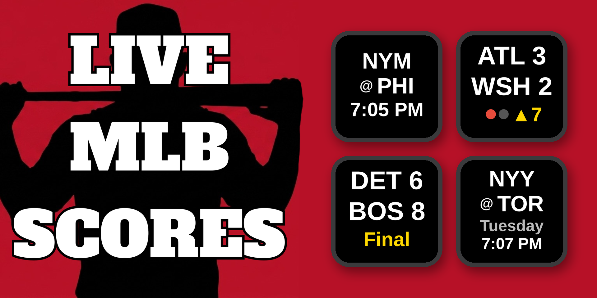
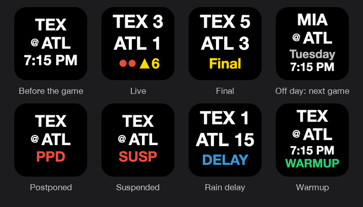
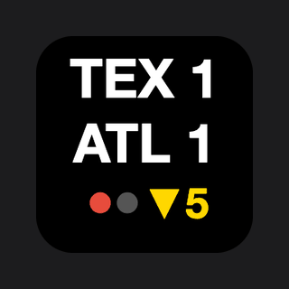
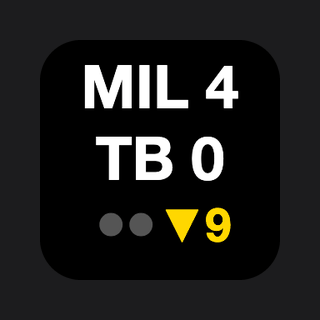
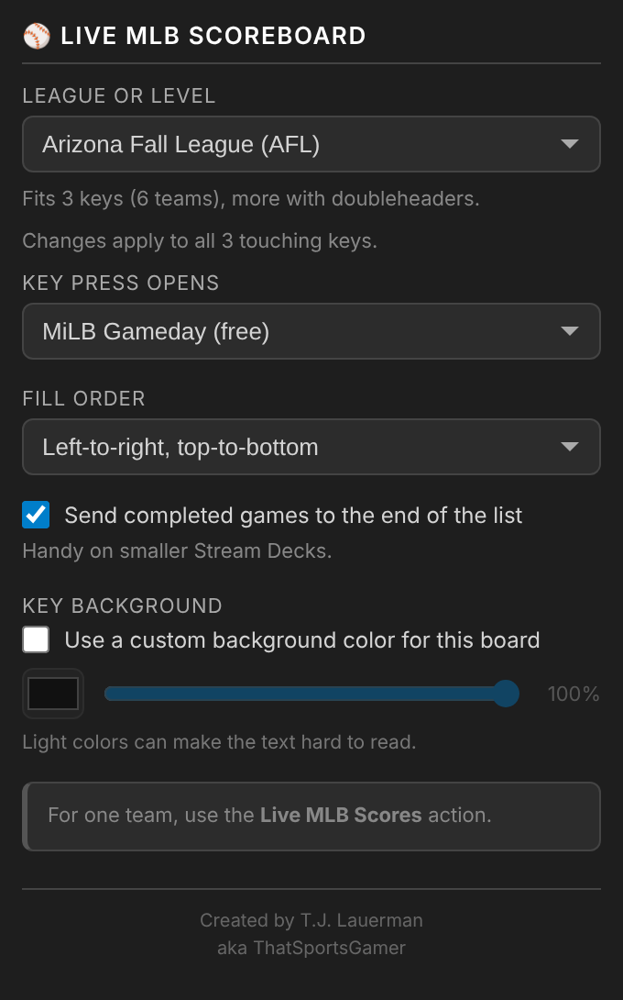
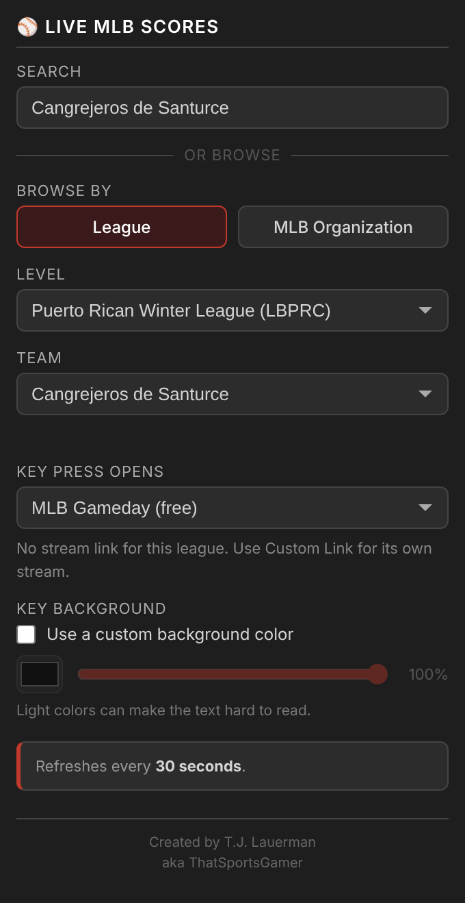

# Live MLB Scores 2.0: Stream Deck Plugin



From Rookie ball to the majors, plus the summer, fall, and winter leagues, keep tabs on your favorite baseball teams right on your Stream Deck. Put a team on a key, or build out a whole scoreboard across your keys. Everything updates automatically.

  [](https://marketplace.elgato.com/product/live-mlb-scores-fbafac13-4e61-4452-b677-5e60fea52639)

> **2.0 is in pre-release.** The Elgato Marketplace still has version 1.0.33 until 2.0 is approved. Want to try 2.0 now? Grab **`Live MLB Scores.streamDeckPlugin`** from the [Releases](../../releases) page. Your existing Live MLB Scores keys keep their team and settings when you upgrade.

<!-- VIDEO: clickable thumbnail linking to the YouTube walkthrough (needs the video ID):
[](https://youtu.be/VIDEO_ID) -->

---

## What's New in 2.0

Live MLB Scores 2.0 combines and expands upon **Live MLB Scores**, **Live MiLB Scores**, and **Live MLB Scoreboard**.

- **Baseball all year long.** From the start of MLB spring training through the Caribbean Series, Live MLB Scores has a league for you.
- **Follow an entire organization.** Like in Live MiLB Scores, you can follow a club's minor-league affiliates, and now that goes all the way down to their Rookie ball teams, for the hardest of hardcore fans. You can also catch their top prospects in the Arizona Fall League.
- **Expand your horizons.** We're going international too: the Australian Baseball League, plus the Caribbean winter leagues from the Dominican Republic (LIDOM), Mexico (LMP), Puerto Rico (LBPRC), and Venezuela (LVBP), all leading up to the Caribbean Series.
- **Amateur leagues too.** The Appalachian League, the historic Cape Cod League, and the MLB Draft League are now in Live MLB Scores.
- **Scoreboard action.** Fill a row or block of keys with a whole day's games for any of the leagues above.
- **A link for every league.** If a key has no game, or a scoreboard has more games than keys, pressing it takes you to that league's schedule page.
- **Clearer heads-up when data stalls.** If one league stops updating, only its keys get a small amber dot. The rest carry on as normal.
- **Suspended games.** They show `SUSP`, then `RESUME` with the start time on the day they pick back up.
- **Night owls welcome.** Australian games follow Sydney time: the morning's finals stay on your keys, and around 1:00 PM Eastern they switch to that night's games. Everywhere else the day doesn't roll over until 5:00 AM Eastern, so late games and their finals stay on your keys.

---

## Features

- **Live scores.** Both scores, the inning with an up or down arrow, and the outs as two dots.
- **Before the game.** The two teams stacked (`ATL` over `@ NYM`) with the start time.
- **Off days.** No dead-end "No Game" here. The key shows your team's next game with its day and time. If there's nothing in the next two weeks, the key shows your team over "Offseason", and a press opens its schedule.
- **Final scores.** The final with a "Final" label, plus fireworks across the key in the winner's color. Minor-league teams use their MLB parent club's color, and any team without a color on file gets gold.
- **Run flash.** The key blinks in the scoring team's color, then shows who scored.
- **Press to watch or follow.** Press a key to open the game on Gameday, in a stream where one's available, or on any link you like (your regional sports network, for example).
- **Doubleheaders.** You'll see the first game, then the second. Double-click the key to peek at the other game.
- **Spring training.** Upcoming spring training and exhibition games get a green `ST` day line (`ST Thu 2/26`, `ST Today`).
- **Split-squad days.** When your team plays two spring games at once, the key shows both on a header card, each matchup over its start time, outs and inning, or Final. Double-tap to step through the header, game one, and game two; the key stays where you leave it. A single tap opens the game you're looking at (it does nothing on the header). Run flashes and fireworks work for both games.
- **Status labels.** `PPD`, `CANC`, `SUSP`, `RESUME`, `DELAY`, and `WARMUP` show up right next to the teams.
- **All-Star Game.** During the break, the key shows the All-Star Game itself.
- **Search.** Type a team, city, or abbreviation and jump straight to it.
- **Your colors.** Pick a background color and opacity for one key or a whole board.
- **No flicker.** Keys only redraw when something actually changes.
- **As many keys as you want.** Each one updates on its own.

<p align="center"></p>

<p align="center"><em>Every key state, drawn by the plugin itself.</em></p>

### Runs and the final out

When a team scores, the key blinks in their color, then a card shows who scored and how many runs before the score comes back.

<p align="center"></p>

When the last out is made, the winner gets fireworks. Here's a replay of the last half inning of the 2026 World Series: Brewers 4, Rays 1.

<p align="center"></p>

<p align="center"><em>Both animations use the same key images the plugin draws. The World Series clip replays the real final half inning, and the run example is a staged game.</em></p>

---

## Leagues

| Level | Leagues | When |
|---|---|---|
| MLB | Major League Baseball, including spring training, the postseason, and the All-Star Game | Spring training through the World Series |
| Minor leagues | Triple-A (International, Pacific Coast), Double-A (Eastern, Southern, Texas), High-A (Midwest, Northwest, South Atlantic), Single-A (California, Carolina, Florida State) | April–September, plus the postseason |
| Rookie | Arizona Complex League (ACL), Florida Complex League (FCL), Dominican Summer League (DSL) | June–August |
| Summer college and draft | MLB Draft League, Cape Cod League, Appalachian League | June–August |
| Fall and winter | Arizona Fall League (AFL), Australian Baseball League (ABL), Dominican winter league (LIDOM), Mexican Pacific League (LMP), Puerto Rican winter league (LBPRC), Venezuelan winter league (LVBP), Caribbean Series | October–early February (the Caribbean Series is in early February) |

Season dates shift a little from year to year.

**What happens when you press a key**

| League | Opens |
|---|---|
| MLB | Gameday (free) or MLB.TV (subscription) |
| Minor leagues | Gameday, or the game's stream if there is one |
| Arizona Fall League | The game's video page when there is one, otherwise the AFL live-streams page; or Gameday |
| LIDOM and LMP | The game's MLB.TV page while it's live, or Gameday |
| Everything else (LVBP, Puerto Rico, ABL, Caribbean Series, Rookie, Draft League, Cape Cod, Appalachian) | Gameday. These leagues don't have a stream link, so the stream option is greyed out in the settings panel, with a note saying why |

Every league also has a **Custom Link** option, so a press can open any page you like, such as your regional sports network.

A Custom Link or stream kicks in once the game is about to start. Before that, and again 30 minutes after the final, pressing the key opens Gameday.

---

## Scoreboard Action

The **Live MLB Scoreboard** action turns a group of keys into one scoreboard for a league.

1. Drag the **Live MLB Scoreboard** action onto a key. New keys start out empty and say "Select a League in Settings".
2. Under **League or Level**, pick MLB or any other league above.
3. Add more Scoreboard keys. Every Scoreboard key with the same settings joins the same board, even if the keys don't touch, and the games fill in the order you choose.

Each game gets its own key, in start-time order, with the same run flashes and final-score fireworks as a team key. If a league has no games today, the board shows its next game day within the next two weeks. With nothing in that window, the first key shows the league over "Offseason" and the rest stay blank.

A few handy options:

- **How many keys.** The settings panel tells you how many keys a league fills: one for every two teams, and more on a day with doubleheaders. Any keys left over show No Game until the board needs them.
- **Fill order.** Top-to-bottom then left-to-right, or left-to-right then top-to-bottom.
- **Send completed games to the end of the list.** Great for smaller Stream Decks (Mini, Neo, a 15-key MK.2). Live and upcoming games keep their keys, and finished games move to the back.
- **+N more.** If there are more games than keys, the last key tells you how many are hidden. Press it to open the league's schedule page.
- **Board background.** Pick a color and opacity for the whole board.
- **Keeping boards apart.** Give a key different settings (a different league, for example) and it becomes its own board, so you can have all of MLB on top and the International League below. Each Stream Deck has its own boards. A settings change covers every touching key with the same settings, so leave a gap if you want to change one group on its own.
- **Removing a key** makes the board re-flow right away.

<p align="center"></p>

---

## Recent Updates

**v2.0.1.0**
- Offseason: when your team has nothing scheduled in the next two weeks, its key shows the team over "Offseason" instead of "No Game". A press still opens the team's schedule
- Scoreboard: on a day with no games, the board now looks up to two weeks ahead for the next game day (was one week). With nothing in that window, the first Scoreboard key shows the league over "Offseason" and the rest go blank; a press still opens the league's scores page
- Spring training: upcoming spring training and exhibition games get a green ST day line ("ST Thu 2/26", or "ST Today" on game day)
- Split-squad days: when your team plays two spring games at once, its key shows both on a header card, each matchup over its start time, outs and inning, or Final. Double-tap to step from the header to game one, game two, and back to the header; the key stays where you leave it. A single tap does nothing on the header and opens the game on a game view. Run flashes and fireworks work for both games
- Fixed: a team key no longer flashes a false run when it moves from one game to another that's already in progress

**v2.0.0.1**
- Australian Baseball League keys now follow Sydney time. The day turns over at 5:00 AM in Sydney (about 1:00 PM Eastern), so the morning's finals stay up through the US morning, then the keys show that night's games with their start times instead of waiting until they go live. Every other league still rolls over at 5:00 AM Eastern

**v2.0.0.0**
- Live MLB Scores, Live MiLB Scores and Live MLB Scoreboard are now one plugin (see What's New in 2.0 above)
- New leagues: Rookie ball (ACL, FCL, DSL), the Arizona Fall League, the Australian Baseball League, the Caribbean winter leagues (LIDOM, LMP, LBPRC, LVBP), the Caribbean Series, and the MLB Draft, Cape Cod and Appalachian leagues
- New **Live MLB Scoreboard** action: fill a group of keys with a whole day's games for any league
- Existing Live MLB Scores keys keep their team and settings when you upgrade

Older updates: see the full version history in [CHANGELOG.md](CHANGELOG.md).

---

## What You'll Need

- An [Elgato Stream Deck](https://www.elgato.com/stream-deck)
- The [Stream Deck software](https://www.elgato.com/downloads), version 7.1 or later (Mac or Windows)
- That's it. No account is needed to see scores. You only need an MLB.TV subscription if you want to use the MLB.TV link option, and Gameday is free.

---

## Installation

**From the Elgato Marketplace (once 2.0 is approved)**

1. Open **[Live MLB Scores on the Elgato Marketplace](https://marketplace.elgato.com/product/live-mlb-scores-fbafac13-4e61-4452-b677-5e60fea52639)** and install it.
2. You'll find it in the Stream Deck action list under **Live MLB Scores**, with two actions: **Live MLB Scores** and **Live MLB Scoreboard**.

**Manual install (pre-release)**

1. Download **`Live MLB Scores.streamDeckPlugin`** from the [Releases](../../releases) page.
2. Double-click it, and Stream Deck takes care of the rest.

---

## Coming From the Other Plugins

**Already using Live MLB Scores 1.x?** Just install 2.0 over it. Your keys keep their team, the Key Press Opens choice, the Custom Link, and the background, so there's nothing to set up again.

**Using Live MiLB Scores or Live MLB Scoreboard?** 2.0 replaces both, but your keys won't move over on their own. For each key:

1. Drag the **Live MLB Scores** action (for a team) or the **Live MLB Scoreboard** action (for a scoreboard) onto the key.
2. Pick the same team or league in the settings panel.
3. Remove the old key.

You can keep the old plugins installed while you switch. They won't get in 2.0's way.

---

## Setup

1. Drag the **Live MLB Scores** action onto any key.
2. Search for your team, or browse by league or MLB organization, then level, league, and team.
3. Choose what a press opens: Gameday, a stream where one's available, or a Custom Link.
4. If you like, pick a background color.

<p align="center"></p>

Your key loads its game within a few seconds and updates every 30 seconds after that.

---

## What the Key Shows

**Before the game:**
```
ATL
@ NYM
7:10 PM
```

**Live game** (the dots are the outs):
```
ATL  3
NYM  1
●● ▼5
```

**Final score:**
```
ATL  3
NYM  1
Final
```

**Off day** (shows the next game, with the weekday, or the date if it's a week or more away):
```
ATL
@ NYM
Thursday
7:10 PM
```

**Offseason** (nothing scheduled in the next two weeks):
```
ATL
Offseason
```

**Postponed:** the teams with a red `PPD`. Canceled games show `CANC`, suspended games show `SUSP`, and a resumed game shows `RESUME` with the time it picks back up.

---

## If Scores Stop Updating

Every so often a league's data takes a break. When that happens, your keys keep showing the last scores with a small amber dot. If there's still nothing after 10 minutes, they show `Err` (a Scoreboard shows `<league> / Err`). Once the data comes back, the keys fix themselves. No need to do anything.

---

## How It Works

The plugin checks [MLB's free public Stats API](https://statsapi.mlb.com) about every 30 seconds. There's no API key or account involved, and it only uses Node.js's built-in modules. The day rolls over at 5:00 AM Eastern (2:00 AM Pacific), so late games and their finals stay on your keys overnight wherever you are. Australian Baseball League keys use Sydney time instead (5:00 AM there, about 1:00 PM Eastern), since the ABL dates its games by the Australian date. Stream links for the leagues that have them are looked up when you press the key.

---

## Uninstalling

Open Stream Deck → Preferences → Plugins, select **Live MLB Scores**, and click the minus (**−**).

---

## Feedback

Found a bug or have an idea? Open an [Issue](../../issues). I'd love to hear from you.

---

## Disclaimer

This plugin is not affiliated with, endorsed by, or sponsored by Major League Baseball, Minor League Baseball, MLB Advanced Media, L.P., or any of the other leagues it shows. All data is sourced from the MLB Stats API and is subject to MLBAM's terms of use. This plugin is intended for individual, personal, non-commercial use only.

---

## Credits

Created by **T.J. Lauerman aka ThatSportsGamer**

Created with Claude Cowork by Anthropic

Data provided by the [MLB Stats API](https://statsapi.mlb.com)
