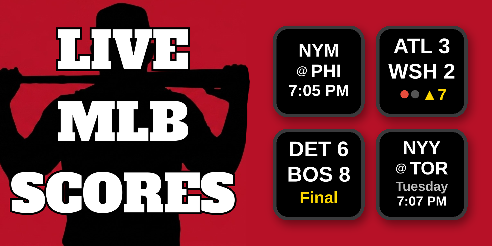
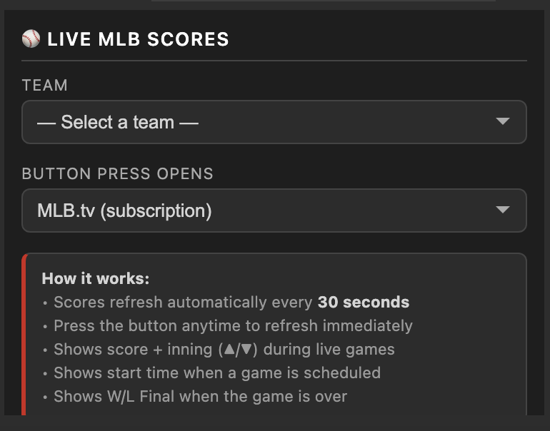
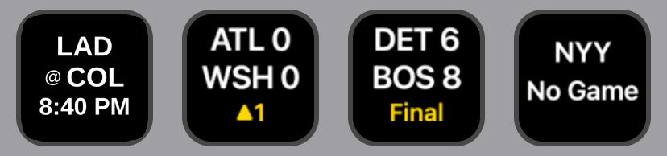

# Live MLB Scores — Stream Deck Plugin



A Stream Deck plugin that shows live MLB scores directly on your keys. Each key tracks one team and updates automatically every 30 seconds.

  [](https://marketplace.elgato.com/product/live-mlb-scores-fbafac13-4e61-4452-b677-5e60fea52639)

---

## Features

- **Live scores** — shows away score, home score, and current inning while a game is in progress
- **Pre-game** — the two teams stacked (`ATL` over `@ NYM`) and the start time; on off days, your team's next game with its day and time
- **Final scores** — shows the final score with a "Final" label
- **Score-change flash** — when a team scores, the key blinks in that team's primary color, then shows a short card with the team and how many runs scored (e.g. ATL / +2 RUNS)
- **Browser shortcut** — press any key to open that game in MLB Gameday, MLB.tv, or a custom link of your choice (e.g. your regional sports network); switches to Gameday automatically 30 minutes after the final out
- **Doubleheader support** — automatically shows Game 1, then switches to Game 2 when it ends; G1/G2 label keeps you oriented
- **Doubleheader toggle** — double-click a doubleheader key to peek at the other game; auto-reverts after 15 seconds
- **No-flicker updates** — keys only redraw when the display actually changes
- **Multi-key support** — add as many team keys as you want, each refreshes independently
- **All-Star Game coverage** — when your team has no game during the All-Star break, the key automatically shows the All-Star Game itself (AL in red, NL in blue) until it's over
- **Next game on off days** — instead of a dead-end "No Game", the key shows your team's next scheduled game with its day and time
- **Custom key background color** — pick your own background color and opacity instead of the default black
- **Search** — type a team, city, or abbreviation to jump straight to it instead of scrolling the dropdown


*The Braves (left, Live MLB Scores) alongside four of their affiliates (Live MiLB Scores), each with its own custom key background color.*

---

## Recent Updates

**v1.0.33.0**
- Fixed: "today" is now read in Eastern time, which is how MLB dates its schedule. Outside the US the keys could ask for tomorrow's slate while tonight's games were still on. The day now changes at 5:00 AM Eastern (2:00 AM Pacific), so late games and their finals stay on the keys overnight everywhere
- Far fewer requests: all your keys now share one request for the day's schedule instead of every key asking for its own team
- If MLB's data stops responding for a moment, keys keep showing the last scores with a small amber dot instead of "Err" (after 10 minutes without an update they show "Err")
- Now runs on Node.js 24 and needs Stream Deck 7.1 or later (Elgato is retiring Node.js 20)

**v1.0.32.0**
- Pregame keys match the NFL, CFB, NHL and NBA plugins: the teams stack on two lines (away team on top, "@ home" below, with a small "@"), then the start time. On game day it's just the teams and the time; for a later day the day gets its own gray line above the time
- Off-day keys show your team's next game the same way: the "Next Game" label is gone, and the day line reads the weekday ("Thursday"), or the date when it's a week or more away
- Doubleheaders put the game number on the day line ("Game 2")
- Postponed, canceled, suspended, delayed and warmup keys use the same stacked teams
- A postseason opponent that isn't decided yet shows its placeholder (e.g. `TB/CLE` for a World Series game) instead of "MLB"

**v1.0.31.0**
- Score flash is now 5 solid blinks of the scoring team's color with no text, so it reads at a glance even on light team colors
- New: right after the flash, a 3-second card shows the scoring team and how many runs scored (e.g. ATL / +2 RUNS), then the score returns
- Settings help text now says "key" instead of "button"

Older updates: see the full version history in [CHANGELOG.md](CHANGELOG.md).

---


## Requirements

- [Elgato Stream Deck](https://www.elgato.com/stream-deck) hardware
- [Stream Deck software](https://www.elgato.com/downloads) version 7.1 or later (Mac or Windows)
- No account required to view scores — the plugin uses MLB's free public stats API
- An MLB.tv subscription is required only if you choose the MLB.tv link option; Gameday is free

---

## Installation

**Elgato Marketplace (recommended)**

1. Open **[Live MLB Scores on the Elgato Marketplace](https://marketplace.elgato.com/product/live-mlb-scores-fbafac13-4e61-4452-b677-5e60fea52639)** and install it from there
2. The plugin will appear in the Stream Deck action picker under **Live MLB Scores**

**Manual install**

1. Download the latest **`Live MLB Scores.streamDeckPlugin`** from the [Releases](../../releases) page
2. Double-click the file — Stream Deck will install it automatically

---

## Setup

1. Drag the **Live MLB Scores** action onto any key
2. In the settings panel on the right, select your team from the dropdown
3. Choose what happens when you press the key:
   - **MLB Gameday (free)** — opens the game's live Gameday page in your browser
   - **MLB.tv (subscription)** — opens the game's MLB.tv broadcast page
   - **Custom Link** — opens any URL you enter, such as your regional sports network's live-game page



That's it. The key will load your team's game within a few seconds and refresh every 30 seconds from there.

> **Note:** If MLB.tv or Custom Link is selected but the game hasn't started yet (more than 60 minutes away), pressing the key will open Gameday instead — a Custom Link with no URL entered behaves the same way. After the final out, the key continues opening MLB.tv/your custom link for 30 minutes to cover post-game coverage, then automatically switches to Gameday.

---

## What the Key Shows



**Before the game:**
```
ATL
@ NYM
7:10 PM
```

**Live game:**
```
ATL  3
NYM  1
 ▲5
```

**Final score:**
```
ATL  3
NYM  1
Final
```

**Off day** (your team's next game — the weekday, or the date when it's a week or more away):
```
ATL
@ NYM
Thursday
7:10 PM
```

---

## How It Works

The plugin polls [MLB's free public Stats API](https://statsapi.mlb.com) once every 30 seconds per key. No API key or account is required. The plugin is fully self-contained — it uses only Node.js built-in modules and requires no external dependencies.

The schedule holds on the current day's games until 5 AM Eastern (2 AM Pacific), so late-running games stay on the key until they finish.

---

## Uninstalling

Open Stream Deck → Preferences → Plugins, select **Live MLB Scores**, and click the **−** key.

---

## Contributing

Bug reports and feature requests are welcome — open an [Issue](../../issues) to get started.

---

## Disclaimer

This plugin is not affiliated with, endorsed by, or sponsored by Major League Baseball or MLB Advanced Media, L.P. All data is sourced from the MLB Stats API and is subject to MLBAM's terms of use. This plugin is intended for individual, personal, non-commercial use only.

---

## Credits

Created by **T.J. Lauerman aka ThatSportsGamer**

Created with Claude Cowork by Anthropic

Data provided by the [MLB Stats API](https://statsapi.mlb.com)
